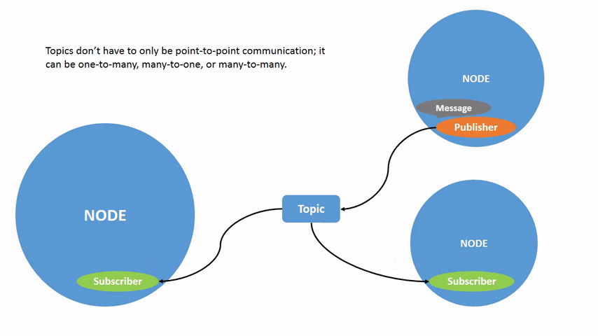

# Natal-Mapping: Using ROS 2 Kilted Kaiju on the Turtlebot 2e Model


## Getting started

This repository has all the code needed for running the model: Turtlebot 2e in ROS2, but some packages need to be built, so please follow this step-by-step instruction for doing so.

This is also made, in part by ________ in they're turtlebot2 ROS2 repo https://github.com/idorobotics/turtlebot2_ros2. They suggest also following these commands on both the docked and workstation laptop:

sudo apt-get install ros-kilted-teleop-twist-keyboard 
ros-kilted-joy-teleop 
ros-kilted-teleop-twist-joy

(This is just making sure you can control the Turtlebot with either the keyboard or a joystick)


## Add your files

- [ ] [Create](https://docs.gitlab.com/ee/user/project/repository/web_editor.html#create-a-file) or [upload](https://docs.gitlab.com/ee/user/project/repository/web_editor.html#upload-a-file) files
- [ ] [Add files using the command line](https://docs.gitlab.com/topics/git/add_files/#add-files-to-a-git-repository) or push an existing Git repository with the following command:

```
cd existing_repo
git remote add origin https://gitlab.cs.unca.edu/csci481/csci481spring26/jbrandy1/natal-mapping.git
git branch -M main
git push -uf origin main
```

## Integrate with your tools

- [ ] [Set up project integrations](https://gitlab.cs.unca.edu/csci481/csci481spring26/jbrandy1/natal-mapping/-/settings/integrations)

## Collaborate with your team

- [ ] [Invite team members and collaborators](https://docs.gitlab.com/ee/user/project/members/)
- [ ] [Create a new merge request](https://docs.gitlab.com/ee/user/project/merge_requests/creating_merge_requests.html)
- [ ] [Automatically close issues from merge requests](https://docs.gitlab.com/ee/user/project/issues/managing_issues.html#closing-issues-automatically)
- [ ] [Enable merge request approvals](https://docs.gitlab.com/ee/user/project/merge_requests/approvals/)
- [ ] [Set auto-merge](https://docs.gitlab.com/user/project/merge_requests/auto_merge/)

## Test and Deploy

Use the built-in continuous integration in GitLab.

- [ ] [Get started with GitLab CI/CD](https://docs.gitlab.com/ee/ci/quick_start/)
- [ ] [Analyze your code for known vulnerabilities with Static Application Security Testing (SAST)](https://docs.gitlab.com/ee/user/application_security/sast/)
- [ ] [Deploy to Kubernetes, Amazon EC2, or Amazon ECS using Auto Deploy](https://docs.gitlab.com/ee/topics/autodevops/requirements.html)
- [ ] [Use pull-based deployments for improved Kubernetes management](https://docs.gitlab.com/ee/user/clusters/agent/)
- [ ] [Set up protected environments](https://docs.gitlab.com/ee/ci/environments/protected_environments.html)

***

# Editing this README

When you're ready to make this README your own, just edit this file and use the handy template below (or feel free to structure it however you want - this is just a starting point!). Thanks to [makeareadme.com](https://www.makeareadme.com/) for this template.

## Suggestions for a good README

Every project is different, so consider which of these sections apply to yours. The sections used in the template are suggestions for most open source projects. Also keep in mind that while a README can be too long and detailed, too long is better than too short. If you think your README is too long, consider utilizing another form of documentation rather than cutting out information.

## Natal Mapping
The migration of adult sea turtles back to the exact beaches where they were born is called Natal Homing, and similarly with the goal of this project, using LiDAR with a TurtleBot 2 to map classrooms, hallways and identifying landmarks to direct first year students to specific classrooms, this is Natal Mapping.

## Description
Let people know what your project can do specifically. Provide context and add a link to any reference visitors might be unfamiliar with. A list of Features or a Background subsection can also be added here. If there are alternatives to your project, this is a good place to list differentiating factors.

This repository will store the code for a ROS2 workspace that will allow the model, Turtlebot 2e, to work in ROS2. This repository also takes the Kobuki base code from the *Idorobotics: Turtlebot2_ROS2* repository and the Astra camera it uses from the *Orbbec: OrbbecSDK_ROS2* repository.

As of the end of Capstone 1, I am hoping that this repository will contain all the code needed for getting the Turtlebot 2e to move completely in ROS2 and the Astra camera to 

## Badges
On some READMEs, you may see small images that convey metadata, such as whether or not all the tests are passing for the project. You can use Shields to add some to your README. Many services also have instructions for adding a badge.

## Visuals
Depending on what you are making, it can be a good idea to include screenshots or even a video (you'll frequently see GIFs rather than actual videos). Tools like ttygif can help, but check out Asciinema for a more sophisticated method.


//Attempting to upload a gif from the ROS2 Kilted Tutorial


## Installation
Within a particular ecosystem, there may be a common way of installing things, such as using Yarn, NuGet, or Homebrew. However, consider the possibility that whoever is reading your README is a novice and would like more guidance. Listing specific steps helps remove ambiguity and gets people to using your project as quickly as possible. If it only runs in a specific context like a particular programming language version or operating system or has dependencies that have to be installed manually, also add a Requirements subsection.

## Usage
Use examples liberally, and show the expected output if you can. It's helpful to have inline the smallest example of usage that you can demonstrate, while providing links to more sophisticated examples if they are too long to reasonably include in the README.

## Support
My email address: jbrandy1@unca.edu

## Roadmap
I am hoping by December of 2025 to have all the code for running a ROS1 Kinetic Turtlebot2e in ROS2 Kilted from this repository alone. In April of 2026, I am planning on either getting a package put together for object identification or building something similar as a stretch goal. I'm not entirely sure how long that will take or if this is enough, but I will hopefully have a definite answer soon. 

## Authors and acknowledgment
The original owners of the *turtlebot2_ros2* and the *ros2_astra_camera* repositories were Bonolo Mathibela and the Orbbec company

## License
The ROS2 code is under the Apache 2.0 License
